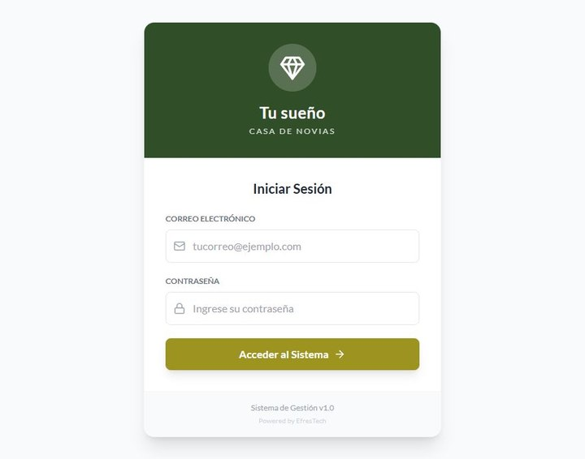
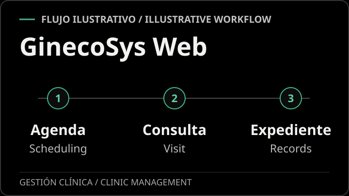
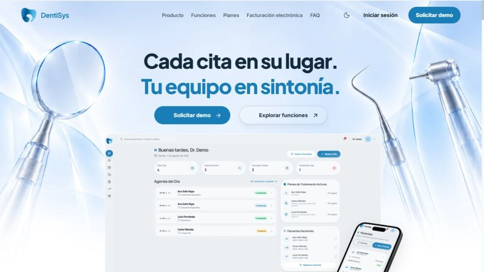

Desarrollo aplicaciones con C#/.NET, Blazor y Kotlin. Mi trabajo abarca comercio electrónico, gestión de información e interfaces para aplicaciones web y móviles.

I build applications with C#/.NET, Blazor, and Kotlin. My work covers e-commerce, information management, and interfaces for web and mobile applications.

## Productos destacados · Featured products

<table>
<tr>
<td width="58%" valign="top">
<h3>Tu Sueño Casa de Novias · EventSys</h3>

Sistema de gestión para coordinar eventos, alquileres e inventario desde un solo lugar. 
An operations platform that brings event planning, rentals, and inventory together.

<strong>Mi aporte · My role:</strong> Implementé los módulos de eventos, alquileres e inventario. / I built the events, rental, and inventory modules.

<a href="https://tu-sueno-casa-de-novia.vercel.app/">Ver acceso al sistema · View sign-in</a>

</td>
<td width="42%" align="center" valign="middle">

</td>
</tr>
<tr>
<td width="58%" valign="top">
<h3>GinecoSys Web</h3>

Sistema web para consultas ginecológicas que reúne la agenda, las consultas y los expedientes clínicos. 
A web app for gynecology practices that brings scheduling, visits, and clinical records together.

<strong>Mi aporte · My role:</strong> Fue mi primer proyecto de gran alcance y lo desarrollé por mi cuenta. / It was my first substantial project, and I built it independently.

</td>
<td width="42%" align="center" valign="middle">

</td>
</tr>
<tr>
<td width="58%" valign="top">
<h3>DentiSys</h3>

Plataforma para clínicas odontológicas que conecta citas, expedientes, tratamientos y presupuestos. 
A dental practice platform that connects appointments, records, treatments, and estimates.

<strong>Mi aporte · My role:</strong> Contribuí al flujo de cierre de consulta y a las pruebas de DentiSys SUITE. / I contributed to the clinical checkout flow and to testing DentiSys SUITE.

<a href="https://dentisys.app/">Sitio oficial · Official site</a> · <a href="https://dentisys.app/explorarfunciones">Explorar funciones · Explore features</a>

</td>
<td width="42%" align="center" valign="middle">

</td>
</tr>
</table>

## Tecnologías · Technologies

| Área · Area | Tecnologías · Technologies |
| :--- | :--- |
| Web | C# · .NET · ASP.NET Core · Blazor · HTML · CSS · Bootstrap |
| Android | Kotlin · Jetpack Compose · Room · Hilt · Retrofit |
| Datos · Data | Entity Framework Core · SQL Server · PostgreSQL |
| Escritorio · Desktop | Java · JavaFX |

## Repositorios públicos · Public repositories

### [GinecoSysApp](https://github.com/Imanol-Acosta/GinecosysApp)

Aplicación Android para gestionar pacientes y consultas ginecológicas, con interfaz en Jetpack Compose y capas de datos, dominio y presentación.

Android application for managing patients and gynecological consultations, with a Jetpack Compose interface and data, domain, and presentation layers.

`Kotlin` `Jetpack Compose` `Room` `Hilt` `Retrofit`

### [KeyStore](https://github.com/Imanol-Acosta/KeyStoree)

Aplicación de comercio electrónico con catálogo de productos, carrito, gestión de pedidos y autenticación con ASP.NET Core Identity.

E-commerce application with a product catalog, shopping cart, order management, and authentication using ASP.NET Core Identity.

`C#` `Blazor` `.NET` `Entity Framework Core` `SQL Server`

### [Registro de estudiantes](https://github.com/Imanol-Acosta/registroEstudiantes)

Aplicación Android para administrar estudiantes, asignaturas y tipos de penalidad, con persistencia local y separación por capas.

Android application for managing students, subjects, and penalty types, with local persistence and a layered structure.

`Kotlin` `Jetpack Compose` `Room` `Hilt`

### [Registro técnico](https://github.com/Imanol-Acosta/RegistroTecnico)

Aplicación web para crear, consultar, editar y eliminar registros de técnicos, con una capa de servicios para el acceso a datos.

Web application for creating, browsing, editing, and deleting technician records, with a service layer for data access.

`C#` `Blazor` `.NET` `Entity Framework Core` `PostgreSQL`

---

[Explora mis repositorios · Explore my repositories](https://github.com/Imanol-Acosta?tab=repositories)
