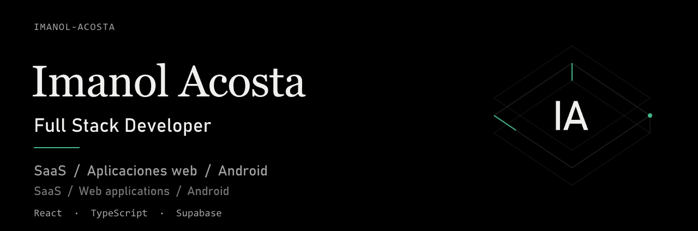
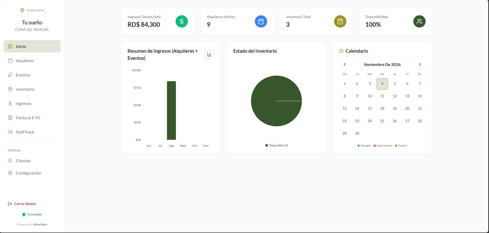
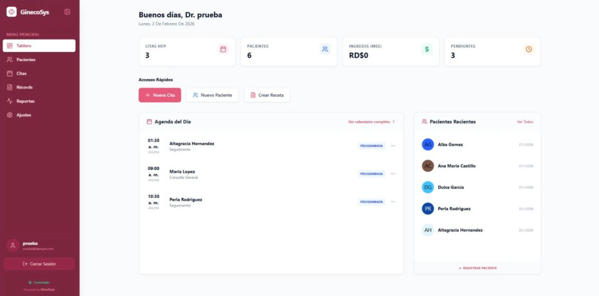
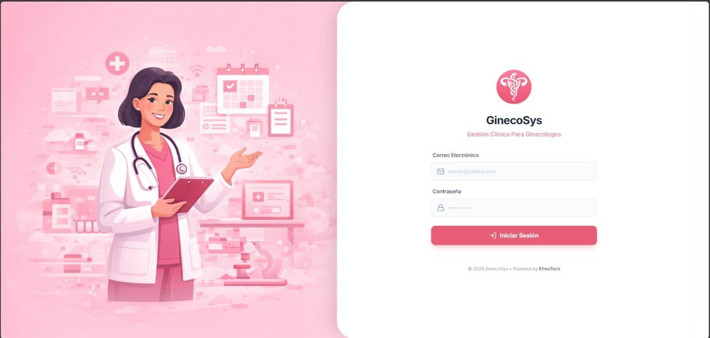

Desarrollo aplicaciones web y SaaS para la operación diaria de negocios y clínicas. Mi trabajo abarca la gestión de eventos y alquileres, la atención ginecológica y la gestión odontológica. También desarrollo aplicaciones nativas para Android.

I build web applications and SaaS products for day-to-day business and clinic operations. My work spans event and rental management, gynecology, and dental practice management. I also build native Android applications.

## Productos destacados · Featured products

<table>
<tr>
<td width="58%" valign="top">
<h3>Tu Sueño Casa de Novias · EventSys</h3>

Sistema de gestión para coordinar eventos, alquileres e inventario desde un solo lugar. 
An operations platform that brings event planning, rentals, and inventory together.

<strong>Mi aporte · My role:</strong> Desarrollé EventSys de principio a fin, incluidos los módulos de eventos, alquileres e inventario. / I built EventSys end to end, including the events, rentals, and inventory modules.

<a href="https://tu-sueno-casa-de-novia.vercel.app/">Ver acceso al sistema · View sign-in</a>

</td>
<td width="42%" align="center" valign="middle">
 Panel principal · Dashboard — clic para ampliar / click to enlarge
</td>
</tr>
<tr>
<td width="58%" valign="top">
<h3>GinecoSys Web</h3>

Sistema web para consultas ginecológicas que reúne la agenda, las consultas y los expedientes clínicos. 
A web app for gynecology practices that brings scheduling, visits, and clinical records together.

<strong>Mi aporte · My role:</strong> Fue mi primer proyecto de gran alcance y lo desarrollé íntegramente por mi cuenta. / It was my first substantial project, and I built it independently from start to finish.

</td>
<td width="42%" align="center" valign="middle">
 Tablero con datos de demostración · Dashboard with demo data
  
 Pantalla de acceso · Sign-in screen
</td>
</tr>
</table>

## Tecnologías · Technologies

| Área · Area | Tecnologías · Technologies |
| :--- | :--- |
| SaaS y aplicaciones web · SaaS & web applications | React · TypeScript · Vite · Tailwind CSS |
| Datos y backend · Data & backend | Supabase · PostgreSQL |
| Android nativo · Native Android | Kotlin · Jetpack Compose · Room · Hilt · Retrofit |
| Desarrollo con .NET · .NET development | C# · ASP.NET Core · Blazor · Entity Framework Core · SQL Server |
| Escritorio · Desktop | Java · JavaFX |

## Repositorios públicos · Public repositories

Muestras de código que complementan los productos destacados: aplicaciones web con .NET y desarrollo nativo para Android.

Code samples that complement the featured products: .NET web apps and native Android development.

| Proyecto · Project | Qué muestra · What it demonstrates |
| :--- | :--- |
| [GinecoSysApp](https://github.com/Imanol-Acosta/GinecosysApp) | Aplicación Android del ecosistema GinecoSys, con módulos de pacientes y consultas. / Native Android app from the GinecoSys ecosystem, with patient and visit modules. **Kotlin · Jetpack Compose · Room** |
| [KeyStore](https://github.com/Imanol-Acosta/KeyStoree) | Comercio electrónico con catálogo, carrito y pedidos. / E-commerce app with a catalog, cart, and order management. **C# · Blazor · SQL Server** |
| [Registro técnico](https://github.com/Imanol-Acosta/RegistroTecnico) | Aplicación web de gestión de registros y acceso a datos. / Web app for managing technician records and data access. **C# · Blazor · PostgreSQL** |
| [Registro de estudiantes](https://github.com/Imanol-Acosta/registroEstudiantes) | Aplicación Android con persistencia local y separación por capas. / Android app with local persistence and a layered structure. **Kotlin · Jetpack Compose · Room** |

[Explora mis repositorios · Explore my repositories](https://github.com/Imanol-Acosta?tab=repositories)
